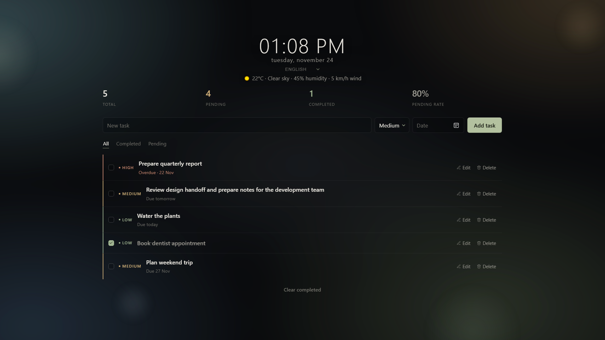

# Task Manager Pro — Glassmorphism Edition

Менеджер завдань на прозорому склі: погода й статистика лежать прямо на фоні,
а за склом видно дощ або сніг залежно від реальної погоди.



## ✨ Можливості

- Завдання: назва, пріоритет, дедлайн, фільтри, статистика
- Погода з Open-Meteo: дощ/сніг за склом, температура, вологість, вітер
- Годинник і дата з вибором мови (Укр, англ, китайська, російська, німецька)
- Адаптивний інтерфейс для телефонів, планшетів, ноутбуків, 2K/4K
- Збереження в `localStorage`

## 🚀 Запуск

```bash
python -m http.server 8000
# → http://localhost:8000
```

Або просто відкрийте `index.html` у браузері.

## 📁 Файли

```
index.html, style.css, app.js, weather.js, preview.png, README.md, LICENSE
```

## 🔒 Приватність

Геолокація використовується лише для запиту погоди до Open-Meteo.

## 📄 Ліцензія

MIT — можна використовувати, змінювати й поширювати.

---

**Версія 1.0**
